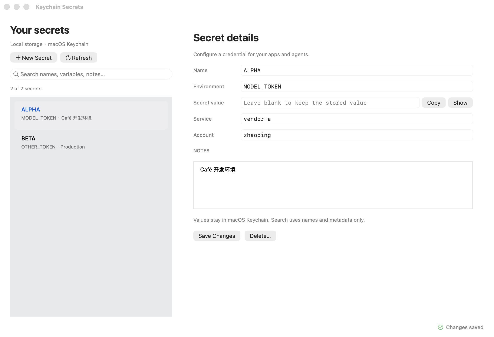

# Keychain Secrets

Manage local API keys and agent credentials with macOS Keychain. Secret values are stored in Keychain; this skill keeps only metadata such as the environment variable name, Keychain service/account, and notes in `~/Library/Application Support/KeychainSecrets/index.json`.



The screenshot uses mock metadata only. It does not contain real secret names or values.

## Install The App

```bash
python scripts/keychain_secrets.py app
```

The native app is installed at:

```text
~/Applications/KeychainSecrets.app
```

Open it later with:

```bash
open "$HOME/Applications/KeychainSecrets.app"
```

## CLI Usage

Store or update a secret without putting the value in shell history:

```bash
python scripts/keychain_secrets.py put OPENAI_API_KEY --prompt --note "OpenAI key for local agents"
```

List managed secrets and metadata:

```bash
python scripts/keychain_secrets.py list
```

Run a command with selected secrets injected as environment variables:

```bash
python scripts/keychain_secrets.py run OPENAI_API_KEY -- python3 your_script.py
```

Delete a managed secret:

```bash
python scripts/keychain_secrets.py delete OPENAI_API_KEY
```

## Native App

Use the app to create, update, reveal, copy, and delete managed entries. The secret field is blank by default when an existing entry is loaded; leave it blank to keep the existing Keychain value while editing metadata.

The app reads metadata from `~/Library/Application Support/KeychainSecrets/index.json` and stores secret values in macOS Keychain. It does not render secret values unless you click `Show`, and it never stores secret values in the metadata file.

Search names, environment variables, Keychain services/accounts, and notes with **⌘F**. Search is case- and accent-insensitive; multiple words narrow the results. It uses metadata only and never reads secret values. Search keeps the current editor and unsaved changes intact even when its entry is filtered out.

The native interface includes a two-line entry list, light/dark appearances, empty-result guidance, and operation progress. Keychain operations run in the background; search stays available while an operation is in progress. Editing and switching entries are paused until that operation finishes. The app asks before discarding unsaved edits.

The bottom-right indicator stays hidden while idle. Unsaved changes and errors persist; operations show a spinning circle, and successful actions show a checkmark circle for three seconds. A newer state always takes precedence over an earlier success timer.

Keyboard shortcuts: **⌘F** search, **⌘N** new secret, **⌘S** save, **⌘R** refresh. Existing CLI commands, flags, metadata paths, and Keychain storage remain compatible.

## Development

Build and reinstall the app (the existing installation is replaced only after a successful build):

```bash
python3 scripts/keychain_secrets.py install-app
```

Run the CLI regression tests and native macOS integration tests:

```bash
bash tests/run_macos_tests.sh
```

The tests use temporary synthetic metadata and mocked Keychain calls. They cover search, ⌘F, unsaved editor preservation, asynchronous process completion, large stdin/stdout/stderr, metadata-save readback, and CLI compatibility. They never read or change your real credentials.

For an additional end-to-end check using synthetic values in a disposable Keychain:

```bash
KEYCHAIN_SECRETS_TEST_REAL_KEYCHAIN=1 bash tests/run_macos_tests.sh
```

That opt-in test checks native save/reveal and CLI injection/deletion, then deletes the temporary Keychain. No existing Keychain entries are read or changed.

To build into a separate location without replacing the installed app:

```bash
KEYCHAIN_SECRETS_APP_DIR=/absolute/path/KeychainSecrets.app bash scripts/install_macos_app.sh
```

For documentation screenshots or local UI testing, point the app at a mock metadata file:

```bash
KEYCHAIN_SECRETS_INDEX_PATH=/path/to/mock-index.json \
  "$HOME/Applications/KeychainSecrets.app/Contents/MacOS/KeychainSecrets"
```

This override only changes where the app reads metadata. It does not change where secrets are stored.

The CLI honors the same `KEYCHAIN_SECRETS_INDEX_PATH` override. Entries from the legacy `~/.codex/keychain-secrets/index.json` location are migrated automatically on first run.

## License

[MIT](LICENSE)
