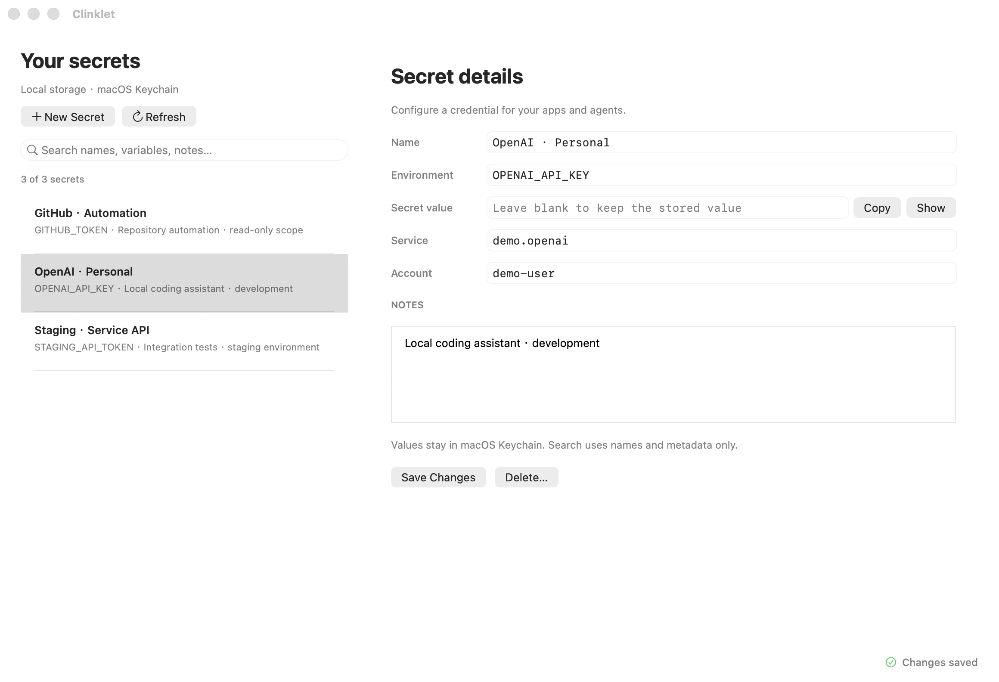
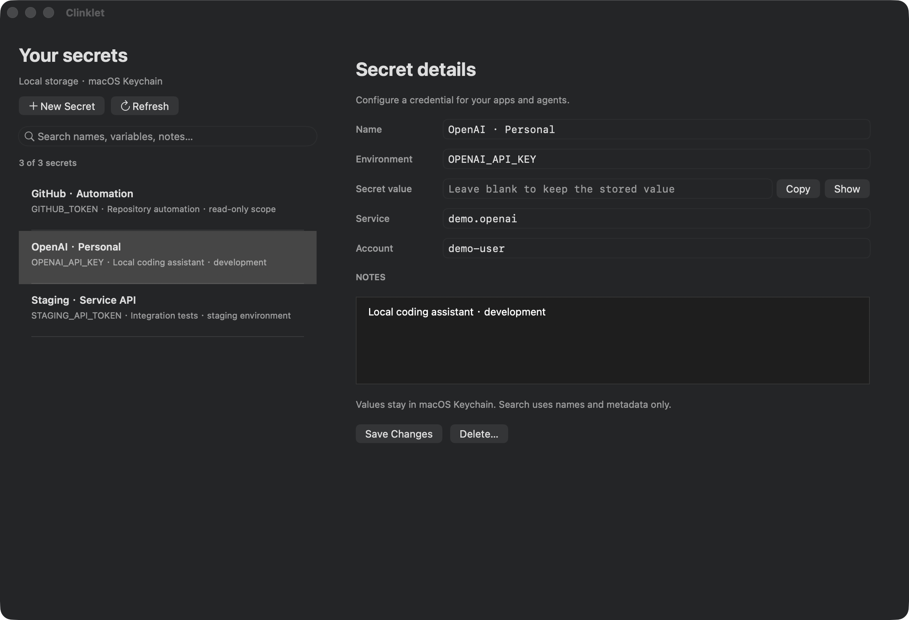

# Clinklet


A small native macOS app for local API keys and agent credentials. Search, edit and copy your keys without digging through Keychain Access.

**[Download the latest macOS release](https://github.com/zpzjzj/clinklet/releases/latest)** · macOS 13+ · Apple Silicon & Intel · no Python or Xcode needed



<details>
<summary>Dark appearance</summary>



</details>

Demo screenshots contain synthetic metadata only. No real credentials are shown.

## Install

1. Download **Clinklet-1.4.0-macOS-universal.dmg** from [Releases](https://github.com/zpzjzj/clinklet/releases).
2. Open the DMG and drag **Clinklet.app** to **Applications**.
3. Open Clinklet. A ZIP of the same app is also available.

The release is ad-hoc signed for integrity, but is **not Developer ID signed or notarized**. If macOS blocks the first launch, attempt to open it, then use **System Settings → Privacy & Security → Open Anyway** and confirm **Open**. You do not need to disable Gatekeeper.

Upgrading from Keychain Secrets: quit the old app and install Clinklet. Existing Keychain entries, metadata paths and bundle identity are retained. The old app bundle can be removed after upgrading; keep your Keychain and metadata files. macOS may ask you to grant Clinklet access when it first opens an entry created by the old app or CLI.

## Use

- **⌘F** searches names, environment variables, Keychain services/accounts and notes. Multiple words narrow the results; matching ignores case and accents.
- **⌘N** creates an entry, **⌘S** saves changes, and **⌘R** refreshes the list.
- The secret field starts blank. Leave it blank to keep the stored value when updating metadata; provide a value to create an entry or change its Keychain identity.
- **Show** reveals a value on demand, and **Copy** places it on the clipboard. Search never reads secret values.
- Entries have clear separators and full-row selection. Search preserves the current editor, even when the entry is filtered out.
- The bottom-right status stays hidden while idle, spins while working, and shows successful actions for three seconds. Unsaved changes and errors remain visible.

All Keychain work runs off the main thread. The desktop app uses Cocoa, Foundation and Security.framework directly, with no subprocess or Python runtime dependency.

Secret values live in macOS Keychain. The JSON index stores only names, environment mappings, service/account identities and notes at:

```text
~/Library/Application Support/KeychainSecrets/index.json
```

That directory name and `KEYCHAIN_SECRETS_INDEX_PATH` remain unchanged for compatibility. The legacy `~/.codex/keychain-secrets/index.json` is migrated automatically on first use.

## Optional CLI / Agent Skill

The existing Python CLI and the `keychain-secrets` skill name remain compatible. **Only this optional CLI requires Python 3.9+**; the downloaded desktop app does not.

```bash
# Store a value without putting it in shell history
python3 scripts/keychain_secrets.py put OPENAI_API_KEY --prompt --note "Local agent key"

# List metadata only
python3 scripts/keychain_secrets.py list

# Inject a selected value into a child process
python3 scripts/keychain_secrets.py run OPENAI_API_KEY -- python3 your_script.py

# Open Clinklet, with fallback to an existing legacy installation
python3 scripts/keychain_secrets.py app
```

Both interfaces read and update the same Keychain items and metadata schema.

## Build and test

Source builds require Xcode Command Line Tools. The native app has no third-party dependencies.

```bash
# Build/install into ~/Applications/Clinklet.app
bash scripts/install_macos_app.sh

# Build elsewhere without replacing your installed app
KEYCHAIN_SECRETS_APP_DIR=/absolute/path/Clinklet.app bash scripts/install_macos_app.sh

# CLI regression and native integration tests (Python is needed by the test harness)
bash tests/run_macos_tests.sh

# Real native/CLI round trips in a disposable Keychain, with synthetic values only
KEYCHAIN_SECRETS_TEST_REAL_KEYCHAIN=1 bash tests/run_macos_tests.sh

# Universal binary, DMG, ZIP and SHA-256 checksums
bash scripts/build_release.sh /absolute/path/to/release-output
```

The native tests cover search, ⌘F, unsaved edits, status timers, background responsiveness, metadata error paths and permissions. The optional Keychain test verifies native creation/reveal, CLI injection/update and native deletion. Existing user credentials are never used by the tests.

For UI previews, set `KEYCHAIN_SECRETS_INDEX_PATH` to a synthetic index when launching the app. The override selects only the metadata file; it does not redirect Keychain storage.

## License

[MIT](LICENSE)
